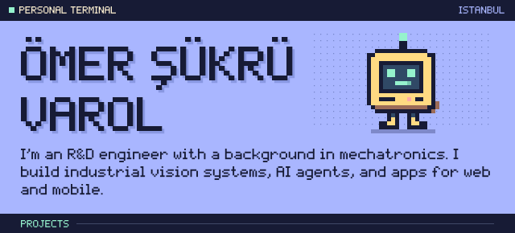
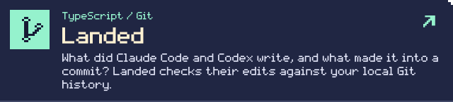
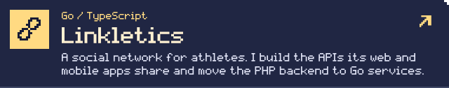
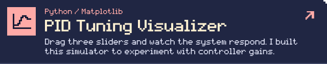

<picture><source media="(max-width: 767px)" srcset="./assets/terminal/en-hero-mobile.svg"></picture>

<a href="https://github.com/omersukruvarol/landed-agents"><picture><source media="(max-width: 767px)" srcset="./assets/terminal/en-landed-mobile.svg"></picture></a>

<a href="https://omersukruvarol.com/#work"><picture><source media="(max-width: 767px)" srcset="./assets/terminal/en-linkletics-mobile.svg"></picture></a>

<a href="https://github.com/omersukruvarol/PID-Tuning-Visualizer"><picture><source media="(max-width: 767px)" srcset="./assets/terminal/en-pid-mobile.svg"></picture></a>

  
