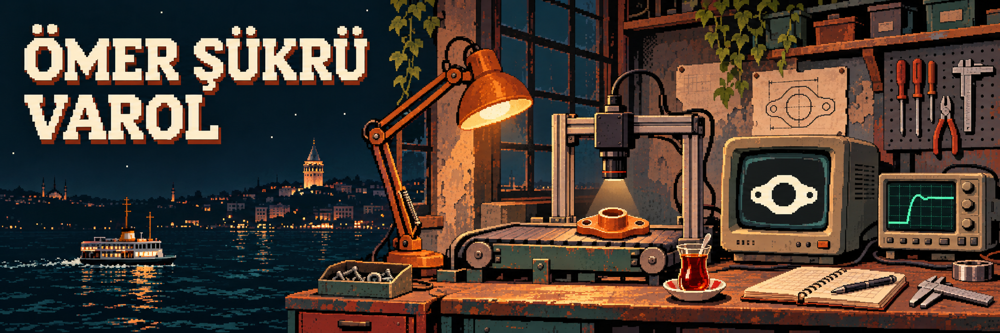

[English](./README.en.md) · [Portfolyo](https://omersukruvarol.com/) · [LinkedIn](https://www.linkedin.com/in/omersukruvarol/)

## Selam, ben Ömer.

Mekatronik kökenli bir Ar-Ge mühendisiyim. İstanbul’da endüstriyel yazılım ve yapay zekâ üzerine çalışıyorum. Python ve OpenCV ile kameralardan gelen görüntüleri işliyor, Jetson üzerinde modeller çalıştırıyorum. Web ve mobil tarafta ise Go ile servisler, TypeScript ile arayüzler geliştiriyorum.

### Tezgâhımdan üç proje

- **[Landed](https://github.com/omersukruvarol/landed-agents)** — Claude Code ve Codex’in yazdığı kodun ne kadarı gerçekten bir commit’e girdi? Landed bu soruyu yanıtlamak için ajan oturumlarını bilgisayarındaki Git geçmişiyle eşleştiriyor.
- **[Linkletics](https://omersukruvarol.com/#work)** — Sporcular için bir sosyal platform. Web ve mobil uygulamaların ortak kullandığı API’leri geliştiriyor, eski PHP/Laravel altyapısını Go servislerine taşıyorum.
- **[PID Tuning Visualizer](https://github.com/omersukruvarol/PID-Tuning-Visualizer)** — Bir kontrol sistemini ayarlarken denklemin grafikteki karşılığını görmek için yazdığım Python aracı. Üç kaydırıcıyla PID katsayılarını değiştirip sistemin hedefe ne kadar hızlı ulaştığını ve hedefi ne kadar aştığını görebilirsin.
