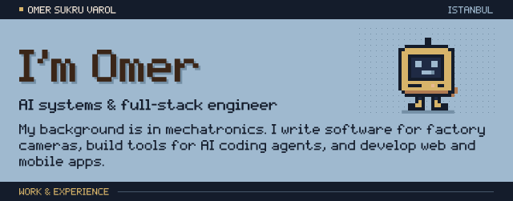
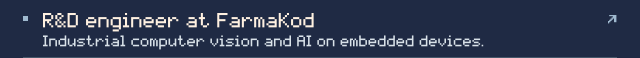
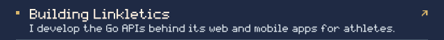
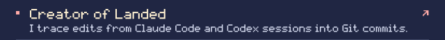
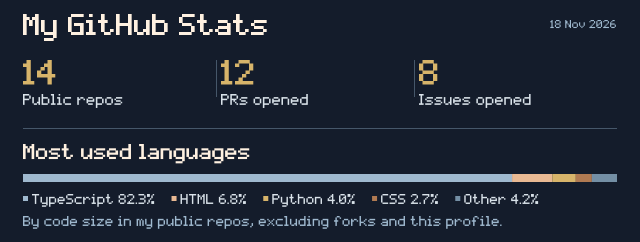

<picture><source media="(max-width: 767px)" srcset="./assets/terminal/hello-mobile.svg"></picture>

<a href="https://omersukruvarol.com/#experience-title"><picture><source media="(max-width: 767px)" srcset="./assets/terminal/farmakod-mobile.svg"></picture></a> 
<a href="https://linkletics.com/"><picture><source media="(max-width: 767px)" srcset="./assets/terminal/linkletics-mobile.svg"></picture></a> 
<a href="https://github.com/omersukruvarol/landed-agents"><picture><source media="(max-width: 767px)" srcset="./assets/terminal/landed-mobile.svg"></picture></a>

  

<picture><source media="(max-width: 767px)" srcset="./assets/terminal/stats-mobile.svg"></picture>
